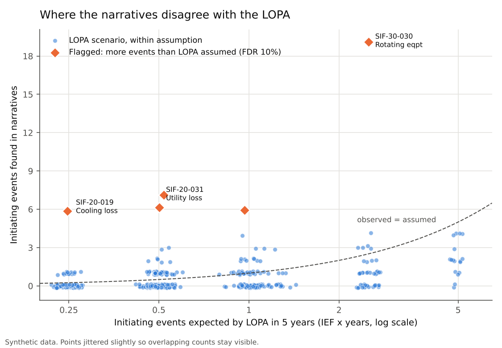
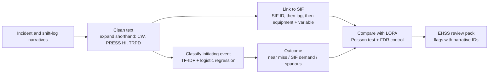

# SIS safety text analytics

**Read years of shift-log and incident narratives, work out which SIF each one is about and what initiated it, and show the EHSS team where real plant history disagrees with the LOPA.**



## Why it matters

A LOPA rests on assumed initiating-event frequencies, such as "BPCS loop failure, 0.1 per year". The evidence that tests those numbers already exists: near misses, alarms the operator caught, SIF trips and spurious trips. But it sits in free-text narratives nobody has time to read against the SIF register. If an initiating event is happening five times more often than assumed, or one the LOPA never considered keeps turning up, the SIL target behind that SIF may be wrong. That is a process-safety gap, not a paperwork one.

This prototype turns the narratives into a review pack: per SIF and per LOPA scenario, how often each initiating event actually happened, how often the SIF was really demanded, and how often it tripped spuriously. Each finding links to the narratives behind it.

## Approach



| Step | Technique | Why this one |
|---|---|---|
| Text cleaning | Rule-based shorthand dictionary | Field logs use a small, known vocabulary (`CW`, `HI`, `TRPD`, `STBY`). Rules are transparent and easy to audit, the same idea as a Power Query clean-up step. |
| SIF linking | Regex for SIF IDs and instrument tags; controller tags (`PIC`) map back to their transmitter; equipment name + process variable as a last resort | Deterministic and explainable. Anything that cannot be linked to exactly one SIF is marked `ambiguous` or `unlinked` and sent for review, never guessed. |
| Initiating-event class | TF-IDF (words + character n-grams) with class-balanced logistic regression; plant IDs masked so the model learns event language, not which unit had which event | Small labelled sets, misspellings and shorthand favour a linear text model. It is fast, and its confidence score can be used to route low-confidence entries to a person. |
| Outcome | Rules: "not demanded / recovered before trip" → near miss, "tripped / activated" → demand | Short, rigid phrases. Rules are clearer than a model here. |
| Comparison with LOPA | Observed events vs IEF × years, one-sided Poisson test, Benjamini–Hochberg false-discovery control at 10% across all scenarios | With ~500 scenarios, a plain p < 0.05 would raise about 25 false alarms by chance alone. FDR control keeps the flag list worth an engineer's time. |

The LOPA table follows the usual independence rule: when the initiating event is a BPCS loop failure, that BPCS loop is not credited as an IPL.

## How it was validated

The data is synthetic (see below), so the generator knows the true answer for every narrative. It also deliberately plants 15 problems: 10 scenarios whose initiating event runs 6–12 times the LOPA frequency, and 5 SIFs that see an initiating event their LOPA never listed. The pipeline never sees the ground truth except as training labels for the classifier, and each narrative is predicted by a model that was not trained on it (5-fold out-of-fold).

Checks before trusting the output:

1. **Classifier vs a simple keyword filter.** The keyword filter is what a quick spreadsheet search would do. It is fooled by context like "cooling water checked normal" in a pump-trip report.
2. **Every link checked against the true SIF.** Precision matters more than coverage here: a wrong link moves an event onto the wrong SIF.
3. **Statistics run twice: on the pipeline's output and on the true labels** ("oracle"). This separates what text analytics loses from what simply cannot be detected in 5 years of rare events.
4. **Six different synthetic plants (seeds),** so the result is not one lucky draw: `python scripts/robustness.py`.
5. **Unit tests** for the regexes, shorthand cleaning, linking rules, Poisson p-values and the FDR calculation (checked against hand-worked values): `pytest`.
6. **Traceability.** Every flag lists the narrative IDs behind it, and every narrative carries its link method and classifier confidence.

## Results on the sample data

Default plant (seed 42): 240 SIFs, 487 LOPA scenarios, 440 narratives over 5 years.

| Measure | Result |
|---|---|
| Initiating-event classifier, macro F1 (out-of-fold) | **0.95** (keyword filter: 0.56) |
| Narratives linked to a SIF | 84%, of which **99.5% to the correct SIF**; the rest go to `Needs_review` |
| Flags raised | **7, all correct** (5 frequency, 2 initiating event not in LOPA) |
| Planted problems found | 7 of 15 |

Across six synthetic plants, the classifier scores 0.87–0.96 macro F1, link precision is 0.99–1.00, and **46 of 47 flags were correct**. Recall of the planted problems ranges from 5 to 12 of 15.

**What the misses mean.** The planted excesses that go undetected are mostly rare initiating events, for example an IEF of 0.05/yr where 5 years gives an expectation of 0.25 events. A ×6 excess there still means only one or two events, which is not enough evidence to separate from chance, even with perfect text analytics (the oracle run also misses most of them). That is itself a useful finding for a PHA revalidation: narratives can confirm the big misses quickly, but rare-event assumptions need longer history or pooled data across similar SIFs.


Outcome rules score 100% here because the synthetic outcome wording is regular. Real logs would need these rules extended and checked on a labelled sample.

## Outputs

`outputs/ehss_review_pack.xlsx`:

| Sheet | Contents |
|---|---|
| Flags | Findings for the EHSS / PHA team, with the narrative IDs behind each |
| Scenario_review | Every LOPA scenario: observed vs assumed initiating-event frequency, SIF demands, p and q values |
| SIF_summary | Initiating events, real SIF demands and spurious trips per SIF |
| Narratives | Each entry with linked SIF, link method, predicted initiating event, confidence and outcome |
| Needs_review | Entries with no unique SIF link or confidence below 0.55 |

A flag is a prompt for engineering review, not a conclusion.

## How to run

```bash
python -m venv .venv && source .venv/bin/activate
pip install -r requirements.txt
python data/generate_synthetic.py     # optional: the sample data is already in data/
python run.py                         # pipeline + validation, writes outputs/ and docs/
pytest                                # unit tests
```

`python scripts/robustness.py` repeats everything on six synthetic plants.

## Repository layout

```
data/generate_synthetic.py   synthetic SIF register, LOPA scenarios, narratives, ground truth
data/ground_truth/           true labels and planted findings (used only for validation and training labels)
src/sis_text/                textclean, extract (linking), classify, analysis (LOPA comparison), pipeline, validate
tests/                       pytest unit tests
outputs/                     review pack, tagged narratives, validation metrics
docs/                        figures
```

## Data note

**All data in this repository is synthetic**, generated by `data/generate_synthetic.py`. Units, tags, equipment, SIFs, LOPA values and narratives are invented. LOPA frequencies are generic textbook orders of magnitude. No employer data, plant documents, tag lists, SIF registers or incident records were used.

This is a public re-implementation of a personal prototype built on sample data. It has not been deployed at any plant, and real narratives would need a labelled sample to retrain and re-check the classifier and rules before any results were relied on.

## Credits

Built with Claude Code; design, requirements and validation by Raja (Rajayoganandha Sekaran).

Licence: MIT.
