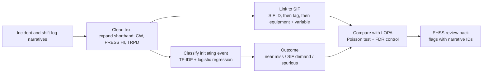
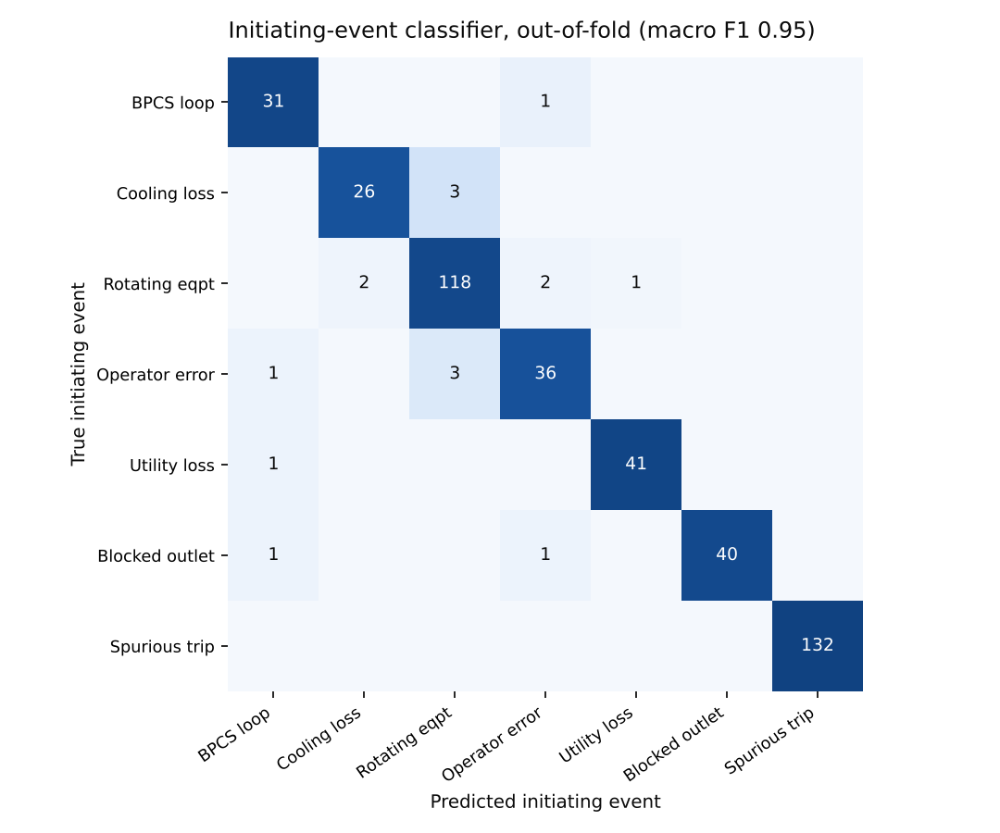

# SIS safety text analytics

**Read years of shift-log and incident narratives, work out which SIF each one is about and what initiated it, and show the EHSS team where real plant history disagrees with the LOPA.**


## Problem statement

A LOPA rests on assumed initiating-event frequencies, such as "BPCS loop failure, 0.1 per year". The evidence that tests those numbers already exists: near misses, alarms the operator caught, SIF trips and spurious trips. But it sits in free-text narratives nobody has time to read against the SIF register. If an initiating event is happening five times more often than assumed, or one the LOPA never considered keeps turning up, the SIL target behind that SIF may be wrong. That is a process-safety gap, not a paperwork one.

This project turns the narratives into a review pack: per SIF and per LOPA scenario, how often each initiating event actually happened, how often the SIF was really demanded, and how often it tripped spuriously. Each finding links to the narratives behind it.

## Features

- Cleans field shorthand (`CW`, `PRESS HI`, `TRPD`, `STBY`) so the same event always reads the same way
- Links each narrative to one SIF, by SIF ID, instrument tag, or equipment + process variable, and never guesses when it is ambiguous
- Classifies the initiating event (7 classes, including spurious trip) with a confidence score, and sends low-confidence entries for review
- Separates near misses, real SIF demands and spurious trips
- Compares observed initiating-event frequency with the LOPA assumption for every scenario, using false-discovery control
- Flags initiating events that a SIF's LOPA never considered
- Writes an Excel review pack for EHSS / PHA review, with a FastAPI endpoint to analyse one narrative at a time

## Tech stack

| Tool | Used for | Why this one |
|---|---|---|
| Python, pandas | Data handling | Standard and readable |
| Regular expressions | SIF and tag extraction | Tag formats are fixed patterns; deterministic and auditable |
| scikit-learn (TF-IDF + logistic regression) | Initiating-event classifier | Small labelled sets with misspellings suit a linear text model; fast, with usable confidence scores |
| SciPy | Poisson test, Benjamini–Hochberg FDR | Correct statistics for rare event counts across ~500 scenarios |
| FastAPI | `/analyse` endpoint | The deployment step from the course: lightweight, with interactive docs |
| openpyxl | Review pack | Engineers work in Excel |
| pytest, GitHub Actions | Tests and CI on every push | Checks the parsing rules and the statistics on every change |

## Approach



| Stage | Where | Technique | Why this one |
|---|---|---|---|
| Data | `src/data/` | Synthetic SIF register, LOPA scenarios and narratives; shorthand dictionary for cleaning | Field logs use a small, known vocabulary. Rules are transparent and easy to audit, the same idea as a Power Query clean-up step |
| Features | `src/features/` | Regex for SIF IDs and tags; controller tags (`PIC`) map back to their transmitter; equipment + process variable as a last resort | Deterministic and explainable. Anything not linked to exactly one SIF is marked `ambiguous` or `unlinked` and sent for review |
| Model | `src/models/` | TF-IDF (words + character n-grams), class-balanced logistic regression, plant IDs masked; outcome by rules | The model learns event language, not which unit had which event. Outcome phrases are short and rigid, so rules are clearer than a model |
| LOPA comparison | `src/lopa/` | Observed events vs IEF × years, one-sided Poisson test, Benjamini–Hochberg FDR at 10% | With ~500 scenarios, a plain p < 0.05 would raise about 25 false alarms by chance |
| Deployment | `src/api/` | FastAPI `/analyse` | Analyse a single new narrative |

The LOPA table follows the usual independence rule: when the initiating event is a BPCS loop failure, that BPCS loop is not credited as an IPL.

## Project structure

```
sis-safety-text-analytics/
├── data/
│   ├── raw/             synthetic SIF register, LOPA scenarios, narratives; ground_truth/ for validation only
│   ├── processed/       tagged narratives, scenario review, flags
│   └── sample/          25 narratives for a quick look
├── models/              saved initiating-event classifier + model card
├── notebooks/           01_walkthrough.ipynb: the whole pipeline step by step, with outputs
├── reports/             ehss_review_pack.xlsx, validation_metrics.json, figures/
├── src/
│   ├── api/             FastAPI service
│   ├── data/            generate_synthetic, load_data, preprocess
│   ├── features/        sif_linking
│   ├── lopa/            compare (Poisson + FDR)
│   ├── models/          classifier, train, evaluate
│   ├── utils/           paths
│   └── pipeline.py      stages wired together
├── tests/               unit and API tests
├── .github/workflows/   CI: tests + full pipeline on every push
├── requirements.txt
├── README.md
└── main.py              runs every stage
```

## How it was validated

The data is synthetic (see below), so the generator knows the true answer for every narrative. It also deliberately plants 15 problems: 10 scenarios whose initiating event runs 6–12 times the LOPA frequency, and 5 SIFs that see an initiating event their LOPA never listed. The pipeline never sees the ground truth except as training labels for the classifier, and each narrative is predicted by a model that was not trained on it (5-fold out-of-fold).

1. **Classifier vs a simple keyword filter.** The keyword filter is what a quick spreadsheet search would do. It is fooled by context like "cooling water checked normal" in a pump-trip report.
2. **Every link checked against the true SIF.** Precision matters more than coverage: a wrong link moves an event onto the wrong SIF.
3. **Statistics run twice: on the pipeline's output and on the true labels** ("oracle"). This separates what text analytics loses from what cannot be detected in 5 years of rare events.
4. **Six synthetic plants (seeds),** so the result is not one lucky draw: `python main.py --robustness`.
5. **Unit and API tests** for the regexes, cleaning, linking rules, Poisson p-values and the FDR maths (checked against hand-worked values), and the `/analyse` endpoint. CI runs them on every push.
6. **Traceability.** Every flag lists the narrative IDs behind it, and every narrative carries its link method and classifier confidence.

## Results

Default plant (seed 42): 240 SIFs, 487 LOPA scenarios, 440 narratives over 5 years.

| Measure | Result |
|---|---|
| Initiating-event classifier, macro F1 (out-of-fold) | **0.95** (keyword filter: 0.56) |
| Narratives linked to a SIF | 84%, of which **99.5% to the correct SIF**; the rest go to `Needs_review` |
| Flags raised | **7, all correct** (5 frequency, 2 initiating event not in LOPA) |
| Planted problems found | 7 of 15 |

Across six synthetic plants, the classifier scores 0.87–0.96 macro F1, link precision is 0.99–1.00, and **46 of 47 flags were correct**. Recall of the planted problems ranges from 5 to 12 of 15.

**What the misses mean.** The undetected excesses are mostly rare initiating events, for example an IEF of 0.05/yr, where 5 years gives an expectation of 0.25 events. A ×6 excess there is still only one or two events, which is not enough to separate from chance, even with perfect text analytics (the oracle run misses most of them too). For a PHA revalidation that is a useful finding in itself: narratives confirm the big misses quickly, but rare-event assumptions need longer history or pooled data across similar SIFs.



Outcome rules score 100% here because the synthetic outcome wording is regular. Real logs would need these rules extended and checked on a labelled sample.

`reports/ehss_review_pack.xlsx`:

| Sheet | Contents |
|---|---|
| Flags | Findings for the EHSS / PHA team, with the narrative IDs behind each |
| Scenario_review | Every LOPA scenario: observed vs assumed initiating-event frequency, SIF demands, p and q values |
| SIF_summary | Initiating events, real SIF demands and spurious trips per SIF |
| Narratives | Each entry with linked SIF, link method, predicted initiating event, confidence and outcome |
| Needs_review | Entries with no unique SIF link, or with confidence below 0.55 |

A flag is a prompt for engineering review, not a conclusion.

## What makes it different

- **It checks the LOPA, not just the text.** Classification is only the means. The output is a statistically controlled comparison with the assumed frequencies, in the terms a PHA team uses.
- **It refuses to guess.** Ambiguous links and low-confidence classifications go to a review list, and every flag cites its evidence.
- **It is honest about what can't be detected.** The oracle comparison shows which misses come from the text analytics and which come from too few events.

## How to run

```bash
python -m venv .venv && source .venv/bin/activate
pip install -r requirements.txt
python main.py                          # all stages: data -> features -> model -> LOPA comparison -> evaluation
pytest                                  # unit and API tests
uvicorn src.api.app:app --reload        # API; open http://127.0.0.1:8000/docs
```

`python main.py --regenerate --seed 7` builds a different synthetic plant, and `python main.py --robustness` repeats everything on six plants. The notebook `notebooks/01_walkthrough.ipynb` steps through the same stages with their outputs.

## What I learned

- **A keyword search is not a baseline to dismiss lightly.** It reached 64% accuracy. But it was fooled exactly where it matters, by negated context ("CW checked normal"), and that was what justified a model.
- **Multiple testing is a practical problem, not a theoretical one.** Without FDR control the flag list would have been mostly noise.
- **Data limits beat model limits for rare events.** The oracle run showed that better text analytics alone would not find the rarest planted problems.
- **The first synthetic data was too easy.** It gave a perfect classifier score, so I made the narratives harder (vague causes, misleading "initially suspected…" chains, unstated causes) until the score was believable.

## Data note

**All data in this repository is synthetic**, generated by `src/data/generate_synthetic.py`. Units, tags, equipment, SIFs, LOPA values and narratives are invented. LOPA frequencies are generic textbook orders of magnitude. No employer data, plant documents, tag lists, SIF registers or incident records were used.

This is a public re-implementation of a personal prototype built on sample data. It has not been deployed at any plant. Real narratives would need a labelled sample to retrain and re-check the classifier and rules before any result could be relied on.

## Credits

Built with Claude Code; design, requirements and validation by Raja (Rajayoganandha Sekaran).

Licence: MIT.
